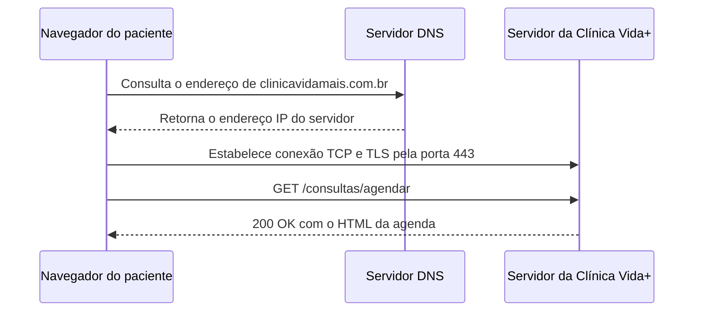

# Arquitetura da Clínica Vida+

## O caminho de uma requisição



**Observação:** o domínio da Clínica Vida+ e a resposta do servidor no diagrama são ilustrativos, pois o sistema ainda está em desenvolvimento.

## Evidência do DNS

Consulta local de `github.com`:

```text
Server:         127.0.0.53
Address:        127.0.0.53#53

Non-authoritative answer:
Name:   github.com
Address: 140.82.113.4
```

Consulta usando o DNS do Google:

```text
Server:         8.8.8.8
Address:        8.8.8.8#53

Non-authoritative answer:
Name:   github.com
Address: 140.82.114.4
```

As consultas de `uni9.br` retornaram `NXDOMAIN` nos dois servidores DNS testados. O domínio `github.com` foi resolvido para endereços IP. O resultado do `ping` para o GitHub apresentou 100% de perda de pacotes, o que não significa necessariamente que o site esteja fora do ar.

## Evidência do HTTP

| Recurso | Método | Status | Tipo |
|---|---|---|---|
| `https://github.com/` | GET | 200 OK | Documento |
| `environments` | Confirmar | 403 | Fetch |
| Recurso CSS | Preencher com o resultado observado | Preencher | CSS |
| Recurso JS ou imagem | Preencher com o resultado observado | Preencher | JS ou imagem |

Os dados da requisição principal e o status `403` de `environments` foram observados na aba Network do navegador. As outras linhas devem ser preenchidas com os dados reais das requisições.

## Por que o formulário de agendamento precisa de HTTPS

O formulário da Clínica Vida+ pode receber dados pessoais sensíveis, como CPF, telefone e data de nascimento. Sem criptografia durante a transmissão, essas informações podem ser interceptadas e lidas por terceiros. O HTTPS usa TLS para proteger os dados em trânsito e ajuda a verificar a identidade do servidor. Por isso, o sistema deve utilizar HTTPS em todas as páginas, especialmente durante o envio do formulário de agendamento.