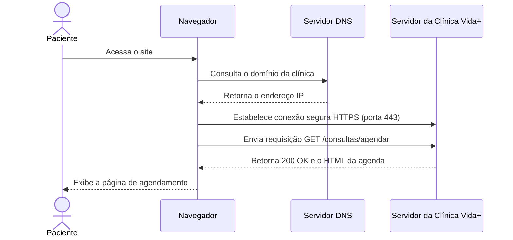

# Arquitetura da Clínica Vida+

## O caminho de uma requisição



**Observação:** o domínio, o endereço IP e a resposta do servidor da Clínica Vida+ são ilustrativos, pois o sistema ainda está em desenvolvimento. O diagrama representa o fluxo esperado de uma requisição.

## Evidência do DNS

### Consulta local de `github.com`

```text
Server:         127.0.0.53
Address:        127.0.0.53#53

Non-authoritative answer:
Name:   github.com
Address: 140.82.113.4
```

### Consulta usando o DNS do Google

```text
Server:         8.8.8.8
Address:        8.8.8.8#53

Non-authoritative answer:
Name:   github.com
Address: 140.82.114.4
```

As consultas de `uni9.br` retornaram `NXDOMAIN` nos dois servidores DNS testados, indicando que o nome consultado não foi encontrado no DNS. Já `github.com` foi resolvido para endereços IP. Os resultados mostram que os servidores DNS consultados retornaram endereços diferentes para o GitHub. O comando `ping` enviou quatro pacotes, mas não recebeu respostas. Isso não significa necessariamente que o GitHub esteja fora do ar, pois respostas de ping podem ser bloqueadas.

## Evidência do HTTP

| Recurso | Método | Status | Tipo |
|---|---|---|---|
| `https://github.com/` | GET | 200 | Documento HTML |
| `environments` | A confirmar | 403 | Fetch |
| `light-3a3d2c708970e4e8.css` | GET | 200 | CSS |
| `element-registry-dd61af1ba176ae38.js` | GET | 200 | JavaScript |

As requisições do documento HTML, do CSS e do JavaScript foram observadas nas ferramentas de desenvolvedor do navegador ou nos arquivos HAR coletados. A requisição `environments` apresentou status `403` em uma captura anterior. O método dessa requisição ainda precisa ser confirmado na ferramenta de desenvolvedor. O status `403` indica que o servidor recusou a solicitação.

## Por que o formulário de agendamento precisa de HTTPS

O formulário da Clínica Vida+ poderá receber dados pessoais, como CPF, telefone e data de nascimento. Sem criptografia durante a transmissão, essas informações podem ser interceptadas e lidas por terceiros. O HTTPS utiliza TLS para proteger os dados em trânsito e ajuda a verificar a identidade do servidor. Por isso, o sistema deverá utilizar HTTPS em todas as páginas, especialmente durante o envio do formulário de agendamento.